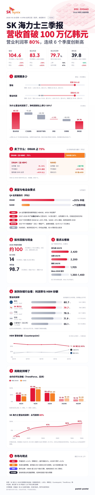
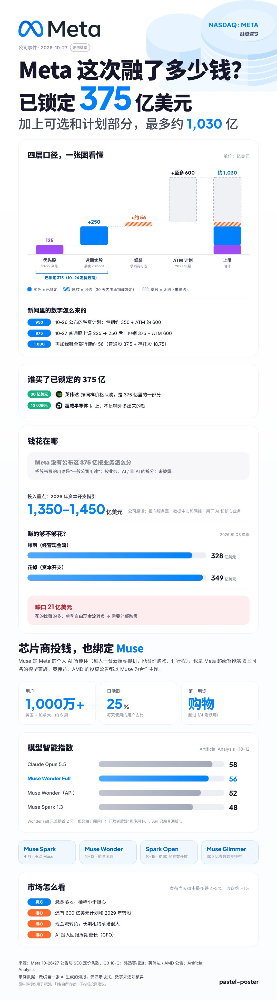
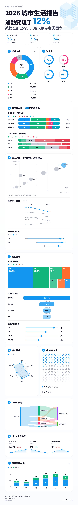
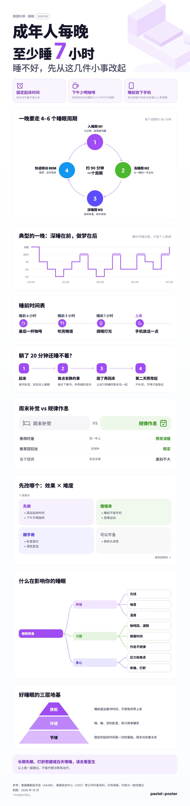
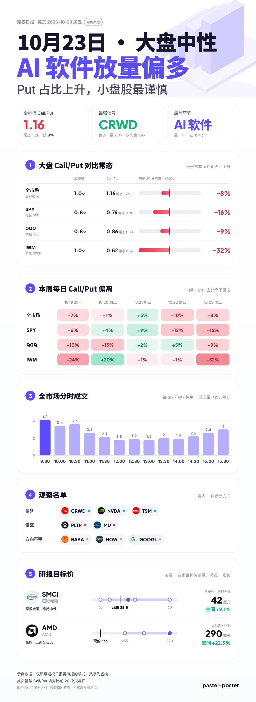
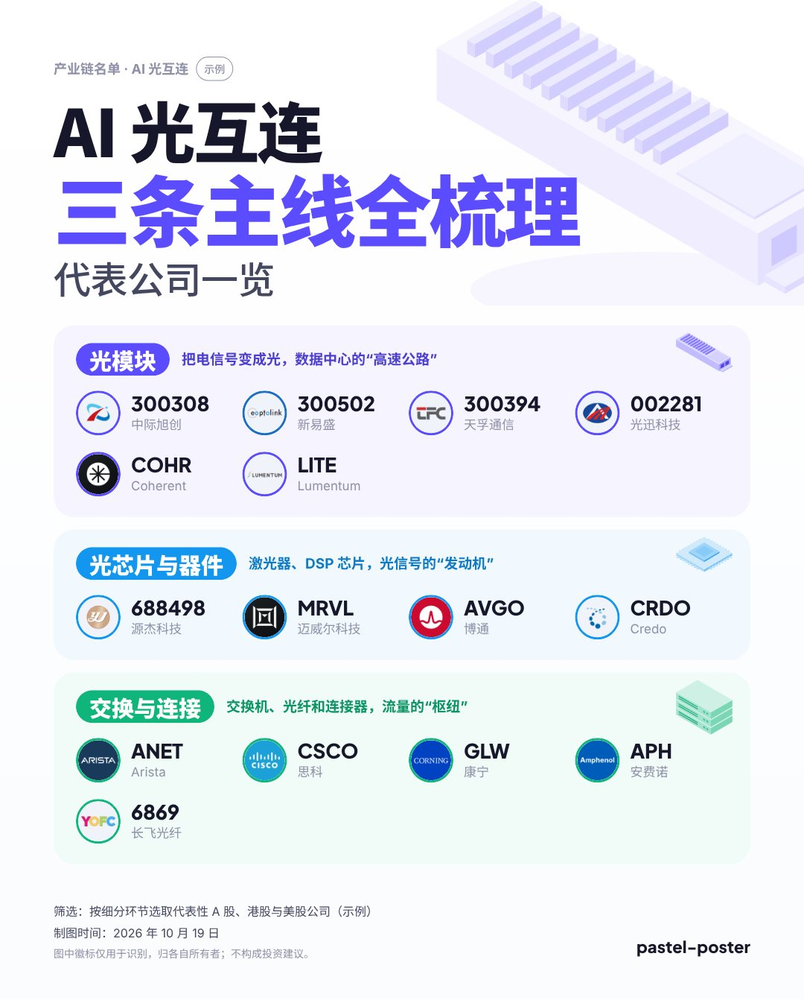
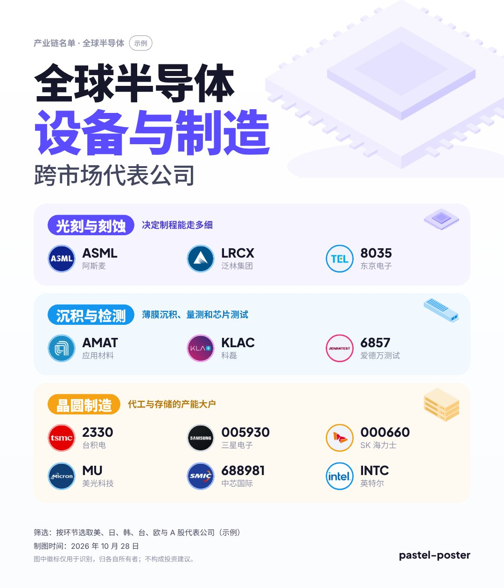
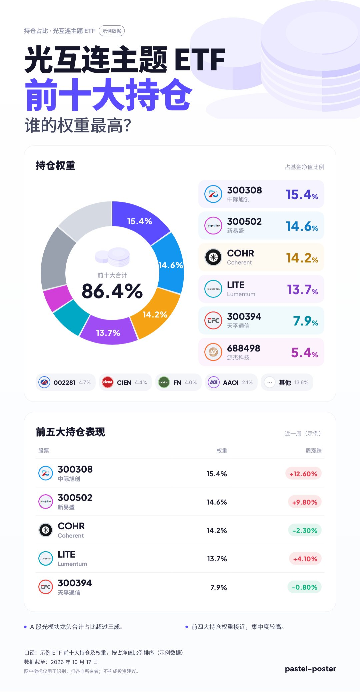
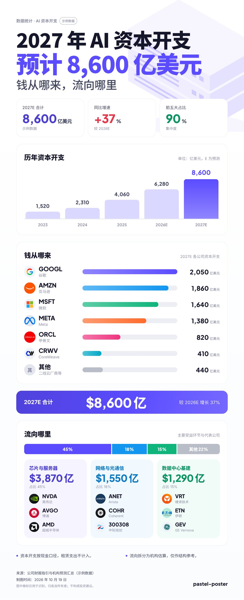

# poster-kit

**pastel-poster**：一个把任何话题做成中文信息海报的 Claude 技能。给它资料或让它上网查，它会按海报类型收集信息、选合适的图表，生成“雾彩·清透”风格的海报网页，再导出高清 PNG。财经（财报、融资、行情、产业链）和日常话题（科普、数据报告、对比评测）都能做。

*A Claude skill that turns any topic into a clean Chinese infographic poster (HTML page + high-res PNG): 40+ chart and layout blocks, icons, official company wordmarks and logos from 68 stock markets.*

<p>




</p>
<p>





</p>

<sub>财报、融资、日报为示例数据，城市生活报告为虚构数据，只演示版式。</sub>

## 能做什么

- **按海报类型出骨架**：财报速览、公司事件、产业链名单、持仓构成、数据统计、行情日报、研报观点、知识科普、通用数据报告、事件始末、对比评测十一种配方，每种带信息收集清单和叙事规则（大标题回答问题、小标题写结论、口径分层、不画示意图），见 [`recipes.md`](skill/pastel-poster/references/recipes.md)。
- **按“想说明什么”选图**：参考 FT 图表词汇表的九类关系（排序、变化、偏差、占比、相关、分布、流向……）和 AntV 的信息结构，整理成 [`charts.md`](skill/pastel-poster/references/charts.md) 选型表和常见错误清单。
- **40 多种版块**：
  - 数据图：横条 / 棒棒糖、柱状（分组、堆叠、区间、预估）、折线、环形、堆叠横条（含态度色阶）、散点 / 气泡（四象限）、坡度、哑铃、矩形树、漏斗、雷达、圆环进度、象形方格、桑基、小多图、热力表、偏离条、瀑布（确定 / 可选 / 计划三档）、实际 vs 预期、目标价刻度
  - 信息结构：时间线、步骤、循环、对比（逐项 / 优缺点）、四象限 / SWOT、树、金字塔、卡片、要点标签、提示框
  - 都不合适时用 `draw` 自己画，配色和字体自动跟海报一致
  - 见 [`sections.md`](skill/pastel-poster/references/sections.md)
- **品牌感**：讲某家公司时头部放官方字标（自动从维基共享资源找，找不到按品牌色文字重建），强调色用品牌色；提到其他公司时自动带 logo。
- **图标**：要点、步骤、时间线、卡片可以写 Lucide 图标名（1500+ 个），生成时内嵌。
- **主题背景物件**：芯片、光模块、服务器、晶圆、数据库、硬币、柱群、电池、楼群、机器人，或用几何块自己拼。
- **真实 logo**：A 股、港股、美股、日韩台、欧洲等 68 个市场，代码写 `SZSE:300308`、`7203.T`、`2330.TW` 都行；取不到自动用首字徽章。
- **先网页、后图片**：海报是一张 1080px 宽的网页，页面上能预览、点按钮下载 2 倍高清 PNG；命令行也能直接导出。
- **页面自包含**：字体按用到的字取子集内嵌，html2canvas 内置，不依赖外部资源，国内打开和导出也稳定。
- **有检查**：生成前检查 spec（字段、公司引用、标题字数、分类数），导出有手机窄屏和字体回退两种场景的自动验收。

## 快速开始

```bash
cd skill/pastel-poster
pip install -r requirements.txt && python3 -m playwright install chromium   # 只生成网页时可以不装

python3 scripts/fetch_logos.py examples/supply-chain.json logos.json
python3 scripts/build_poster.py examples/supply-chain.json logos.json poster.html --standalone --png poster.png
```

打开 `poster.html` 预览，或直接用 `poster.png`。不加 `--standalone` 输出的是 claude.ai Artifact 页面片段。

## 在 Claude 里使用

1. 到 [Releases](../../releases/tag/latest) 下载 `pastel-poster.zip`，在 Claude 的技能设置里上传（只需要第一次）。
2. 对 Claude 说“做一张 AI 光互连产业链的海报”之类的话，技能会按 [`SKILL.md`](skill/pastel-poster/SKILL.md) 的流程收集数据、写 spec、取 logo、生成并检查海报。
3. 技能每次使用前会自动拉取本仓库 main 分支的最新版，所以改动推到 main 就生效，不用重新上传。fork 后把 `SKILL.md` 第 0 步里的仓库名换成自己的。

## 结构

```
poster-kit/
├─ skill/pastel-poster/        技能本体（打包上传的就是这个目录）
│  ├─ SKILL.md                 流程与要点
│  ├─ references/              海报配方、图表选型、版块、配色、风格、版式关卡、logo 规则、spec.schema.json
│  ├─ scripts/
│  │  ├─ fetch_logos.py        取 logo：手工修正版 → logo 仓库 → 可选 TradingView → 首字徽章
│  │  ├─ build_poster.py       spec.json + logos.json → 海报网页（--png 直接出图）
│  │  ├─ render_png.py         海报网页 → PNG
│  │  ├─ validate_spec.py      检查 spec
│  │  ├─ find_wordmark.py      找公司官方字标 SVG
│  │  └─ test_export.py        导出验收
│  ├─ assets/                  海报模板、html2canvas
│  └─ examples/                完整示例 spec
├─ assets/logo-overrides/      手工修正的 logo（不打包，取 logo 时在线读取）
├─ docs/images/                README 效果图
└─ .github/workflows/          CI（示例验收）与发布（推 main 自动更新 latest 安装包）
```

## 配置 logo 来源

默认来源是 [MrChartist/global-stock-logos](https://github.com/MrChartist/global-stock-logos)。可用环境变量换成自己的 fork 或修正图目录：

```bash
export POSTER_LOGO_REPOS="me/global-stock-logos@main,MrChartist/global-stock-logos@main"
export POSTER_LOGO_OVERRIDES="/path/to/my-overrides,https://raw.githubusercontent.com/me/poster-kit/main/assets/logo-overrides"
```

对某个 logo 不满意：把文件放进 `assets/logo-overrides/`，命名 `{交易所}_{代码}.png` 或 `.svg`（如 `SZSE_300308.png`、`HKEX_700.svg`），推送即可生效。

## 更新

修改 `skill/pastel-poster/` 推到 main 即可：CI 会跑示例验收，已安装的技能下次使用时自动拉到新版；工作流同时更新 Releases 里的 `latest` 安装包，给第一次安装的人用。

## 版权

代码以 [MIT](LICENSE) 协议提供；图标来自 [Lucide](https://lucide.dev)（ISC），生成时按需下载内嵌。公司 logo 归各自所有者，仅用于识别；logo 仓库的数据来源和条款见其 [DATA-SOURCES](https://github.com/MrChartist/global-stock-logos/blob/main/DATA-SOURCES.md)。海报内容不构成投资建议。
